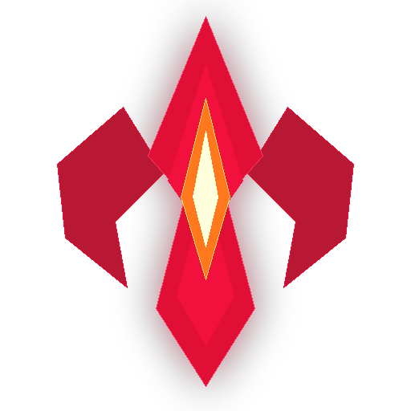

# Flare Macro - TDS

<p align="center">
  
</p>

<p align="center">
  <b>High-performance, automated coin-farming macro and tactile cyberpunk desktop suite for Roblox Tower Defense Simulator.</b>
</p>

<p align="center">
  
  
  
  
</p>

---

## Overview

**Flare Macro - TDS** is an autonomous automation framework designed from the ground up for high-efficiency Roblox Tower Defense Simulator farming. Engineered with native Windows OCR, pixel-perfect DirectInput hardware events, dynamic computer vision, and a modern cyberpunk desktop interface.

### Highlights & Features

- **Autonomous Match & Intermission Automation**:
  - Automatically joins Solo queues, reads lobby currencies, verifies Golden Scout skin equipping.
  - Detects maps on voting boards, navigates elevator pads, or walks to the Override console to force **Dead Ahead**.
  - Automatically configures and votes for **Game Modifiers** (Glass, Exploding Enemies) in intermission to boost coin payouts.
- **Dead Ahead Optimal Coin Farm**:
  - Full automated deployment of up to 16-20 Scouts along calibrated track boundaries.
  - Upgrades each Scout to Level 2 early, then dynamically maxes out each tower in sequence before final waves.
  - Seamless match conclusion handling: OCRs rewards, tracks coins & gems, and automatically triggers **Play Again**.
- **Battlepass Farm (Seasonal Drop Sweeper)**:
  - Toggleable periodic patrol sweeps along the track to vacuum up seasonal event tokens, crystals, sickles, and dropped items.
  - Net-zero displacement movement returns the character safely back to their original position without interrupting tower upgrades.
- **Tactile Cyberpunk UI**:
  - Frameless carbon-dark desktop panel with chamfered gamer geometry and neon crimson accents (`#F2113D`).
  - **Interactive Gamer Keycaps**: Click-to-bind physical hotkey mapping with a custom dark palette modal.
  - **Dedicated Modifier Selector**: Interactive challenge modifier selector with live reward bonus calculation.
- **Floating Click-Through HUD Overlay**:
  - Frameless translucent on-screen HUD docked at the top-right corner.
  - Configured with Win32 `WS_EX_TRANSPARENT | WS_EX_LAYERED` so all mouse clicks pass straight through into Roblox.
- **Discord Webhooks & Analytics**:
  - Instant dispatch on Triumph / Defeat.
  - Error and crash logging with diagnostic traceback context.
  - Hourly session performance digests with win rate, coin rates, and wave counts.
- **Resolution Independence**:
  - Dynamic coordinate scaling engine that adjusts overhead click targets across 1080p, 1440p, 4K, and ultrawides.

---

## Hotkeys

| Action | Default Key | Customizable | Description |
| :--- | :---: | :---: | :--- |
| **Start / Resume** | `F1` | Yes | Launches the active queue or resumes execution |
| **Pause / Resume** | `F2` | Yes | Halts player movement and pauses the macro loop |
| **Emergency Stop** | `F3` | Yes | Immediately releases all keyboard inputs and stops |
| **Toggle HUD Overlay** | `F7` | Yes | Toggles the in-game click-through HUD overlay |

> Hotkeys are globally monitored via Windows asynchronous hooks and work even when the macro panel is minimized.

---

## Installation & Setup

### 1. Prerequisites
- **Operating System**: Windows 10 or Windows 11 (64-bit)
- **Python**: Version 3.10, 3.11, or 3.12
- **Roblox**: Installed and running TDS in Fullscreen or Windowed mode

### 2. Clone Repository
```powershell
git clone git@github.com:akmalriyas/TDS-Macro.git
cd TDS-Macro
```

### 3. Install Dependencies
```powershell
pip install -r requirements.txt
```

---

## Running the Macro

### Launch the Modern GUI
```powershell
python -m tds_macro ui
```

### Run via Command-Line Interface (Headless / Terminal)
```powershell
# Run a single Dead Ahead Coin Farm match
python -m tds_macro run --preset dead_ahead_coin_farm

# Run continuously with unlimited loops
python -m tds_macro run --preset dead_ahead_coin_farm --loops 0
```

---

## Project Structure

```text
├── tds_macro/
│   ├── assets/              # App branding, logo icons, map tiles
│   ├── flows/
│   │   ├── lobby.py         # Matchmaking, intermission, and modifier voting
│   │   ├── match.py         # In-match troop placement & upgrade flow
│   │   └── runloop.py       # Main continuous execution & webhook dispatch
│   ├── ui/
│   │   ├── app.py           # PyWebView multi-window application
│   │   ├── backend.py       # IPC bridge between Web UI and Macro engine
│   │   └── web/             # HTML5 / CSS3 / ES6 front-end and HUD
│   ├── capture.py           # Per-monitor DPI desktop capture
│   ├── config.py            # Global run settings and resolution scaling
│   ├── core.py              # Macro orchestrator
│   ├── input.py             # Hardware DirectInput simulation
│   ├── ocr.py               # Windows Media OCR engine
│   ├── queue.py             # Persistent task queue
│   ├── state.py             # Game state detection & machine
│   ├── watchdog.py          # Win32 asynchronous hotkey watchdog
│   └── webhook.py           # Discord webhook notifications
├── requirements.txt         # Python package dependencies
├── .gitignore               # Ignored files (logs, tokens, scratch)
└── README.md                # Documentation
```

---

## Author & Credits

Made with ♥ by **Akmal Riyas**
