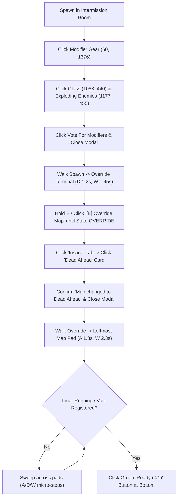

# 14. CLI & Engine Implementation Specification (Iteration 1)

**Date:** October 2026  
**Target Package:** `tds_macro/`

---

## 1. Overview

Iteration 1 completes the autonomous CLI macro engine (`python -m tds_macro ...`) so that it can loop `Dead Ahead` (Easy + Glass + Exploding Enemies) indefinitely using Golden Scouts, track Coins/Gems/XP per run, and recover from any stuck state or disconnect.

---

## 2. CLI Commands (`tds_macro/__main__.py`)

| Command | Description |
|---|---|
| `python -m tds_macro doctor` | Checks DPI awareness, window detection (`RobloxPlayerBeta.exe`), capture backend (`dxcam`/`mss`), OCR (`winocr`), and current screen state + currencies. |
| `python -m tds_macro snap [label]` | Captures a frame + runs OCR and saves both `.png` and `.txt` to `%TEMP%\tds_macro`. |
| `python -m tds_macro watch` | Live 1 Hz terminal status ticker (`State`, `Coins`, `Gems`, `Cash`, `Wave`). |
| `python -m tds_macro lobby` | Executes Lobby flow once (`read_lobby_currencies` -> one-time `check_scout` -> `Play -> Survival -> Easy -> Solo`). |
| `python -m tds_macro intermission` | Executes Intermission flow once (`Modifiers -> Override Insane/Dead Ahead -> Map Selector Board -> Ready`). |
| `python -m tds_macro match` | Executes In-Match flow once (`Camera Setup -> 10-15 Golden Scouts -> Wave Skip -> Triumph/Play Again`). |
| `python -m tds_macro run` | Runs the complete infinite loop (`runloop.run_forever`) with hourly Coins/Gems/XP tracking and rich terminal table output. |
| `python -m tds_macro ui` | Launches the Iteration 2 `customtkinter` Control Panel + Win32 click-through HUD overlay. |

---

## 3. Core Engine Enhancements (`tds_macro/core.py` & `tds_macro/config.py`)

### 3.1 Session Flags & Lifecycle Control
- `m.scout_checked: bool = False`: Ensures `check_scout(m)` only runs **once** at the start of a macro session (`Step 2` requirement).
- `m.paused: bool = False` and `m.stop_requested: bool = False`: Checked inside `m.sleep(seconds)` and main loops so `F6` (Pause) and `F8` (Stop) respond within `< 100 ms`.
- `m.on_status_change`: Optional callback invoked whenever state, wave, cash, scouts placed, or run log metrics update (used by Iteration 2 UI and HUD overlay).

### 3.2 Accurate In-Match Cash & Tower Counter Reading
From `refs/Screenshot 2026-10-21 222117.png`, the in-round cash (`$1,649`) and tower count (`10 / 41`) sit immediately to the right of hotbar slot 5 (`x ≈ 1480..1750, y ≈ 1280..1420` at `2560x1440`):
- `CASH_REGION = (1300, 1240, 1260, 200)`
- `read_cash(frame)` scans `CASH_REGION` for `$NNN,NNN` tokens first, falling back to integer OCR on the green cash label.
- `read_tower_count(frame)` scans `CASH_REGION` for `\b(\d{1,2})\s*/\s*(\d{2})\b` (e.g. `10 / 41` -> `(10, 41)`), allowing the macro to verify whether a tower placement actually succeeded!

### 3.3 Camera Zoom Keys (`I` and `O`)
In addition to mouse wheel scrolling, Roblox supports holding `I` (zoom in) and `O` (zoom out), which works reliably even when the cursor overlaps GUI elements:
- `m.zoom_in(duration=0.4, wheel_clicks=5)`
- `m.zoom_out(duration=0.6, wheel_clicks=8)`

---

## 4. Corrected Intermission Flow (`tds_macro/flows/lobby.py`)

---

## 5. In-Match Gameplay Flow (`tds_macro/flows/match.py`)

### 5.1 Camera & Street-Light Alignment (`setup_camera_and_position`)
1. Move cursor to `(1280, 500)` and pitch camera straight down: `inp.rotate_camera(0, 650)`.
2. Zoom out (`O` key for `0.6s`) to bring the road and the bright neon-green spawn chevron (`H: 45..85, S: 150..255, V: 180..255`) into view.
3. Locate the neon-green chevron on the road; walk (`W`/`A`/`D`) until the player stands next to the **highest street light** just below the green chevron (`target_y ≈ 0.25 * H`).
4. Zoom back in slightly (`I` key for `0.25s`) so the placement zone below the street light fills the center of the viewport (`refs/Screenshot 2026-10-21 221752.png`).

### 5.2 Opening Sequence (`place_initial_scout_and_ready`)
1. Press `1` to select Golden Scout (`$250`).
2. Click Slot #0 `(1140, 680)` (just left of the road below the street light crossbar, `refs/Screenshot 2026-10-21 221836.png`).
3. Click the placed Scout at `(1140, 680)` to select it and press `E` once to upgrade to **Level 1 (`$100`)**.
4. Click the green **`Ready? -> Yes`** button at top-center (`(950, 80, 660, 220)`).
5. As soon as cash reaches `$250` (or every `1.0s` over the next `6s`), press `E` with Scout #0 selected to upgrade it to **Level 2 (`$250`)**.

### 5.3 10–15 Golden Scout Placement & Upgrade Loop (`run_match`)
- **Placement Coordinates (`2560x1440` reference offsets around `(1280, 720)`)**:
  - **Left Inner Column** (along left road edge): `(1140, 680)`, `(1140, 790)`, `(1140, 900)`, `(1140, 1010)`
  - **Left Outer Column**: `(1030, 720)`, `(1030, 830)`, `(1030, 940)`, `(1030, 1050)`
  - **Right Inner Column** (along road center median): `(1390, 680)`, `(1390, 790)`, `(1390, 900)`, `(1390, 1010)`
  - **Right Outer Column**: `(1500, 720)`, `(1500, 830)`, `(1500, 940)`
- **Phase A — Place `N` Scouts (default `12`, configurable `10–15`) & Upgrade Each to Level 2**:
  - For each slot `i` in `0 .. N-1`:
    - While waiting for cash (`$250` to place, `$100` for L1, `$250` for L2), continuously click **`Skip Wave? -> Yes`** at top-center (`(950, 80, 660, 220)`).
    - Press `1`, click `(sx, sy)` (trying micro-offsets `(0,0), (-22,0), (22,0), (0,-22), (0,22)` if tower count/cash didn't change), then click the placed tower and press `E` twice as cash allows to bring it to **Level 2**.
- **Phase B — Max All Placed Scouts to Level 4 Before Wave 20**:
  - Cycle through all placed Scout coordinates `(sx, sy)`:
    - Click `(sx, sy)` to open its upgrade panel, press `E` (`1–2` times) to upgrade toward **Level 3 (`$950`)** and **Level 4 Max (`$2,550`)**, then press `Q` or click neutral ground if needed.
    - Keep clicking **`Skip Wave? -> Yes`** every tick to maximize clear speed (~7m 15s per run).

### 5.4 Victory Screen & `Play Again` (`parse_results_and_continue`)
- When `State.VICTORY` or `State.DEFEAT` is detected (`refs/Screenshot 2026-10-21 222652.png`):
  - OCR the results card for:
    - `coins_earned` (`(\d+)\s*coins`, e.g., `450`)
    - `xp_earned` (`\+?(\d+)\s*xp`, e.g., `93`)
    - `match_time_s` (`(\d+)m\s*(\d+)s`, e.g., `7m 15s` -> `435s`)
    - `wave_reached` (`wave:\s*(\d+)`, e.g., `20`)
  - Record to `RunLog` (`logs/runs.jsonl` and `logs/runs.csv`).
  - If `settings.use_play_again` is `True`, click **`Play Again`** (`click_text("play again")` or `click_green((1250, 950, 750, 350))`), which sends the player directly into the next match's Intermission room!
