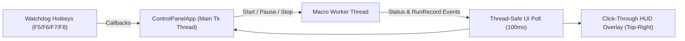

# 15. Lightweight Control-Panel UI & Transparent HUD Overlay Spec (Iteration 2)

**Date:** October 2026  
**Target Modules:** `tds_macro/ui/app.py`, `tds_macro/ui/overlay.py`, `tds_macro/watchdog.py`

---

## 1. Design Philosophy

Following the principles documented in [08-ui-design-revolution.md](08-ui-design-revolution.md) and Emil Kowalski's UI engineering standards:
- **Task-shaped, compact, and dark-themed (`760 x 540`)**: Uses `customtkinter` (already installed in Python 3.11) with a crisp dark surface hierarchy (`#0D0F14` base, `#151922` cards, `#22C55E` emerald active accents, `#F59E0B` gold coin accents, `#A855F7` gem accents) and tabular monospace numbers (`Consolas` / `Cascadia Mono`) so live counters never jitter.
- **Built-in Hourly Money & Gems Chart**: A custom `tkinter.Canvas` time-series chart rendering cumulative Coins, Gems, and rolling **Coins/hr** across completed runs so the user gets immediate visual feedback on their farming efficiency.
- **Click-Through Win32 Transparent HUD Overlay**: A borderless top-most window (`WS_EX_LAYERED | WS_EX_TRANSPARENT | WS_EX_TOPMOST`) positioned in the top-right corner of the Roblox window showing current state, wave, cash, scouts placed, Coins/hr, and active hotkeys without intercepting any mouse clicks.

---

## 2. Architecture & Threading Model

- **Main Thread**: Runs the `customtkinter.CTk` event loop (`ControlPanelApp`) and the child `tk.Toplevel` transparent HUD overlay (`HudOverlay`).
- **Macro Worker Thread**: Runs `runloop.run_forever(m, log, settings)` in a daemon thread so screen capture, OCR, and input simulation never freeze the UI.
- **Global Hotkey Watchdog (`tds_macro/watchdog.py`)**: Polls Win32 `GetAsyncKeyState` at 25 Hz in a lightweight background thread so hotkeys work even while Roblox has full-screen focus:
  - `F5` — Start / Resume Macro
  - `F6` — Pause / Unpause Macro
  - `F7` — Toggle On-Screen HUD Overlay
  - `F8` — Emergency Stop (immediately releases all held keys `W`/`A`/`S`/`D`/`E`/`I`/`O` and halts the worker)

---

## 3. Control Panel Layout (`tds_macro/ui/app.py`)

1. **Top Header Bar**:
   - Title (`TDS MACRO v2.15 — Dead Ahead Golden Scout`), live status pill (`IDLE` / `RUNNING` / `PAUSED`), and quick action buttons (`F5 Start`, `F6 Pause`, `F7 Overlay`, `F8 Stop`).
2. **KPI Metric Strip (5 Cards with Tabular Monospace Figures)**:
   - **Coins & Coins/hr**: Current lobby coins + rolling hourly rate (e.g. `103,769  (+3,720/hr)`).
   - **Gems & Gems/hr**: Current lobby gems + rolling hourly rate.
   - **XP/hr & Avg Clear**: Rolling XP/hr and average match duration (`7m 15s`).
   - **Runs (W / L)**: Total wins, losses, and win rate %.
   - **Live Match State**: Current state (`GAMEPLAY`), Wave (`14/20`), In-Round Cash (`$1,649`), and Scouts (`12/12`).
3. **Center Split Pane**:
   - **Left: Hourly Coins & Gems Chart (`tkinter.Canvas`)**: Plots Coins/hr per run and cumulative Coins/Gems earned over session time, automatically updating after each `RunRecord` (and loading historical runs from `logs/runs.jsonl` on startup).
   - **Right: Strategy & Session Settings Card**:
     - Target Scouts slider (`10` to `15`, default `12`)
     - Toggle: `Use "Play Again" on Victory` (default `On`)
     - Toggle: `Verify Golden Scout on Start` (default `On`, runs once per session)
     - Button: `Run Doctor Check`
4. **Bottom Live Log Console**:
   - Auto-scrolling timestamped log stream showing every state transition, OCR reading, tower placement, and Victory summary.
